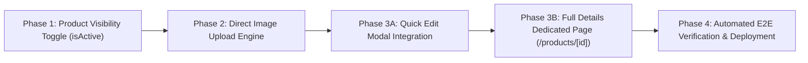

# Cure-Care (curecarebd.com) — Comprehensive Technical Documentation & Project Manual

> **Last Updated:** October 23, 2026 (01:45 AM UTC+6)  
> **Repository:** `ahktek/Auron` (`new-ecom`)  
> **Production URL:** [https://curecarebd.com](https://curecarebd.com)  
> **Internal Administrative Portal:** `https://curecarebd.com/curecare-internal-8921`  
> **Author/Maintainer:** Antigravity Advanced Agentic Pair Programming & Engineering Team  

---

## 1. Executive Summary & Brand Foundation

### 1.1 Brand Overview
**Cure-Care Bangladesh** (`CureCare`) is a high-performance wellness and herbal care e-commerce platform specializing in authentic imported and natural pain-relief remedies, herbal soothing balms, therapeutic hair oils, and pure essential oils. The catalog is curated from trusted traditional herbal manufacturers, including premium items imported from Thailand and Southeast Asia.

- **Primary Domain:** `https://curecarebd.com`
- **Brand Slogan:** *Authentic Herbal Wellness & Targeted Comfort*
- **Primary Market:** Bangladesh (Nationwide delivery across all 64 districts)
- **Currency Authority:** Bangladeshi Taka (BDT `৳`)
- **Visual Identity:**
  - **Brand Teal (Primary):** `#005A64` (Deep Medical Forest Teal)
  - **Teal Light / Subtle:** `#EAF4F5`
  - **Teal Hover:** `#01454D`
  - **Brand Coral (Accent / CTA):** `#FF6857` (Energetic Therapeutic Coral)
  - **Coral Hover:** `#E04B36`
  - **Dark Base / Canvas:** `#0A0A0C` (Admin & Dark Surfaces) / `#FFFFFF` (Storefront Canvas)
  - **Typography:** Geometric Sans-serif (`DM Sans`, Inter) with system font fallbacks.

---

## 2. Complete Architecture & Technology Stack

```
                              ┌─────────────────────────────────────────┐
                              │            Client Browser               │
                              │ (Storefront & Authenticated Admin Portal)│
                              └────────────────────┬────────────────────┘
                                                   │ HTTPS (Port 443)
                                                   ▼
                              ┌─────────────────────────────────────────┐
                              │       Hostinger Cloud Edge / CDN        │
                              │ (DDoS Protection, SSL, Static Caching)  │
                              └────────────────────┬────────────────────┘
                                                   │
                                                   ▼
                              ┌─────────────────────────────────────────┐
                              │     LiteSpeed Web Server + Passenger    │
                              │  (Reverse Proxy / Node.js Process Sup.) │
                              └────────────────────┬────────────────────┘
                                                   │ Unix Socket / IPC
                                                   ▼
                              ┌─────────────────────────────────────────┐
                              │    Next.js 15.5.27 (Standalone Server)   │
                              │       React 19.1.0 / Node.js 22 LTS     │
                              ├─────────────────────────────────────────┤
                              │ • Next.js App Router (RSC & Client)     │
                              │ • Edge Middleware Guard (src/middleware)│
                              │ • REST API Endpoints (/api/...)         │
                              │ • JOSE HMAC-SHA256 Token Engine         │
                              └───────┬─────────────────────────┬───────┘
                                      │                         │
                         File I/O Sync│                         │Prisma ORM
                                      ▼                         ▼
            ┌───────────────────────────────────┐    ┌─────────────────────┐
            │       High-Speed JSON Stores      │    │    MySQL Database   │
            │   (public_html/data/*.json)       │    │ (u505959191_curecare│
            │ • products.json   • orders.json   │    │  User accounts,     │
            │ • categories.json • settings.json │    │  audit logs, RBAC)  │
            └───────────────────────────────────┘    └─────────────────────┘
```

### 2.1 Core Frameworks & Libraries
| Component | Technology | Version | Purpose / Role |
| :--- | :--- | :--- | :--- |
| **Framework** | Next.js (App Router) | `15.5.27` | Hybrid SSR, SSG, and client-side rendering with streaming |
| **UI Library** | React & React DOM | `19.1.0` | Modern React compiler, concurrency, and portal rendering |
| **Language** | TypeScript | `5.x` | Strict type validation across models, APIs, and client state |
| **Styling** | Tailwind CSS | `4.x` | Modern CSS variable theme engine, `@import "tailwindcss"` |
| **Icons** | Lucide React | `1.52.0` | Comprehensive tree-shakeable SVG icon kit |
| **Security/JWT**| JOSE | `6.2.12` | Lightweight edge-compatible JWT signing and verification |
| **Hashing** | Argon2 / Crypto PBKDF2 | `@node-rs/argon2` | OWASP-compliant cryptographic password storage |
| **ORM** | Prisma Client | `6.19.3` | Relational database schema authority and query builder |
| **Database** | MySQL 8 / MariaDB | Hostinger Cloud | Persistent relational store for users, orders, and audits |
| **File Persistence**| Node.js `fs/promises` | Native Node 22 | Low-latency JSON flat-file storage for catalogs & settings |
| **Deployment** | LiteSpeed Passenger | Standalone Mode | High-efficiency process supervisor on Hostinger Cloud |

---

## 3. Route Map & Endpoint Directory

### 3.1 Public Storefront Routes
| Route | Component File | Description |
| :--- | :--- | :--- |
| `/` | `src/app/page.tsx` | Homepage featuring hero banner, trust indicators, bestsellers, category showcase, and customer testimonials. |
| `/products` | `src/app/products/page.tsx` | Full catalog browsing page with filters, sorting, and price range. |
| `/products/[slug]` | `src/app/products/[slug]/page.tsx` | Product Detail Page (PDP): Image gallery, variant selection, price, stock badges, benefits accordion, customer reviews, and sticky Add-to-Bag bar. |
| `/products/category/[...slug]` | `src/app/products/category/...` | Filtered category collection view (e.g. `soothing-balms`, `hair-oils`). |
| `/cart` | `src/app/cart/page.tsx` | Full shopping bag with order summary, promo code application, and subtotal calculation. |
| `/checkout` | `src/app/checkout/page.tsx` | High-conversion 1-click Cash on Delivery (COD) & Online Checkout form (Customer Name, Phone, Full Delivery Address, District selection, Delivery charge). |
| `/checkout/success` | `src/app/checkout/success/page.tsx` | Order confirmation screen with tracking ID and delivery estimate. |
| `/orders/[id]` | `src/app/orders/[id]/page.tsx` | Real-time order tracking with status milestones (Pending, Processing, In Transit, Delivered). |
| `/search` | `src/app/search/page.tsx` | Full search results page with live keyword highlighting. |
| `/about` | `src/app/about/page.tsx` | Brand heritage, sourcing ethos, and quality commitment. |
| `/contact` | `src/app/contact/page.tsx` | Customer support inquiry form, WhatsApp hotline, and location. |
| `/privacy`, `/terms`, `/cookies`| `src/app/{legal}/page.tsx` | Compliance, privacy, terms of service, and cookie policy pages. |

### 3.2 Enterprise Obfuscated Administrative Portal (`/curecare-internal-8921/*`)
> [!IMPORTANT]
> The public `/admin` path is permanently blocked and returns a generic 404. All administrative controls are hosted strictly under the obfuscated prefix `/curecare-internal-8921` guarded by edge middleware.

| Route | Component File | Description |
| :--- | :--- | :--- |
| `/curecare-internal-8921/login` | `src/app/curecare-internal-8921/login/page.tsx` | Brute-force protected admin login gateway with 5-attempt rate limiter. |
| `/curecare-internal-8921` | `src/app/curecare-internal-8921/page.tsx` | Admin Overview Dashboard: Live sales metrics, today's orders, revenue, inventory alerts, and quick actions. |
| `/curecare-internal-8921/products` | `src/app/curecare-internal-8921/products/page.tsx` | **Products & SKUs Catalog**: Complete CRUD management, instant category/search filtering, stock tracking, and modal editor. |
| `/curecare-internal-8921/categories`| `src/app/curecare-internal-8921/categories/page.tsx`| Category hierarchy management, curations, and navigation reordering. |
| `/curecare-internal-8921/orders` | `src/app/curecare-internal-8921/orders/page.tsx` | Orders & Fulfillment: Customer verification, address inspection, courier tracking assignment, and fulfillment status updates. |
| `/curecare-internal-8921/reviews` | `src/app/curecare-internal-8921/reviews/page.tsx` | Review Moderation: Approve verified purchaser reviews, reject fake/spam submissions. |
| `/curecare-internal-8921/discounts`| `src/app/curecare-internal-8921/discounts/page.tsx`| Promo code generator: Percentage / fixed BDT discounts, expiry dates, and usage limits. |
| `/curecare-internal-8921/journal` | `src/app/curecare-internal-8921/journal/page.tsx` | Editorial CMS: Herbal wellness articles, lifestyle guides, and announcements. |
| `/curecare-internal-8921/media` | `src/app/curecare-internal-8921/media/page.tsx` | Media Library: Asset browser, image URLs, and product photography management. |
| `/curecare-internal-8921/settings` | `src/app/curecare-internal-8921/settings/page.tsx` | Global Store Settings: Delivery charges (Inside Dhaka ৳70, Outside Dhaka ৳130), contact info, banner notices, social links. |
| `/curecare-internal-8921/audit-log`| `src/app/curecare-internal-8921/audit-log/page.tsx`| Immutable security log recording admin actions, IP addresses, and timestamps. |

### 3.3 REST API Directory
| Method | Endpoint | Access Level | Description |
| :--- | :--- | :--- | :--- |
| `POST` | `/api/curecare-internal-8921/auth/login` | Public (Rate-limited) | Validates admin credentials, issues signed `auren_admin_session` HttpOnly cookie. |
| `DELETE`| `/api/curecare-internal-8921/auth/login` | Authenticated | Clears admin session cookies and signs out immediately. |
| `GET` | `/api/curecare-internal-8921/products` | Admin Cookie Required | Fetches full product list with inventory counts and categories. Supports `?category=` and `?query=`. |
| `POST` | `/api/curecare-internal-8921/products` | Admin Cookie Required | Creates a new product SKU in `data/products.json` with generated slug. |
| `PUT` | `/api/curecare-internal-8921/products` | Admin Cookie Required | Updates existing product pricing, inventory, category, or metadata. |
| `DELETE`| `/api/curecare-internal-8921/products`| Admin Cookie Required | Permanently deletes a product SKU by ID. |
| `GET/PUT`| `/api/curecare-internal-8921/categories`| Admin Cookie Required | Fetches or updates store categories and navigation ordering. |
| `GET/PUT`| `/api/curecare-internal-8921/orders` | Admin Cookie Required | Fetches live customer orders or updates fulfillment status. |
| `GET/PUT`| `/api/curecare-internal-8921/settings` | Admin Cookie Required | Reads and writes store settings (delivery fees, banners, phone). |
| `POST` | `/api/checkout/orders` | Public | Submits a customer order with validation and inventory deduction. |
| `GET` | `/api/health` | Public | Healthcheck endpoint returning server uptime, timestamp, and memory. |

---

## 4. Security, Cryptography & Obfuscation System

### 4.1 Edge Guard Architecture (`src/middleware.ts`)
The edge middleware inspects every inbound HTTP request before Next.js route handling:
1. **Public Honeypot Guard:**
   - Any request to `/admin` or `/admin/*` is immediately terminated with a standard **404 Not Found**, completely hiding the existence of an administrative portal.
2. **Protected Route Perimeter:**
   - Any request matching `/curecare-internal-8921/*` (except `/curecare-internal-8921/login` and static asset chunks) requires valid cryptographic session credentials.
   - If the request lacks `auren_admin_session` or the token is invalid/expired, the middleware issues a 307 temporary redirect to `/curecare-internal-8921/login`.
3. **API Protection:**
   - Inbound requests to `/api/curecare-internal-8921/*` (except `/auth/login`) verify the signed JWT in the request headers/cookies. Unauthenticated calls receive `{ success: false, error: "Unauthorized" }` with HTTP 401.

### 4.2 Cryptographic Tokens & Authentication
- **Algorithm:** HMAC-SHA256 (`HS256`) via `@node-rs/argon2` and `jose`.
- **Token Claims:** `sub` (User ID), `email`, `role` (`OWNER`), `name`, `iat` (issued at), `exp` (expires in 8 hours), `iss` (`auren:admin`).
- **Cookie Security Attributes:**
  - `HttpOnly: true` (Prevents client-side JavaScript / XSS access)
  - `Secure: true` (Strictly transmitted over HTTPS)
  - `SameSite: Strict` (Eliminates Cross-Site Request Forgery / CSRF)
  - `Path: "/"`
- **Brute-Force Rate Limiting:**
  - IP-based sliding window: Maximum **5 attempts per 60-second window**.
  - Exceeding 5 failures triggers an automatic **15-minute temporary IP lockout** returning HTTP 429.

### 4.3 Zero Frontend Footprint
- All admin links, buttons, and badges have been completely scrubbed from the public storefront layout:
  - Header navigation: Public links only (Shop, Balms, Oils, Journal, About, Cart).
  - Footer navigation: Brand, Customer Care, Legal, and Contact info.
  - Account login: Customer-only authentication; no staff/admin toggle.

---

## 5. Data Storage & Persistence Layer

The application utilizes a high-reliability dual storage architecture:

### 5.1 JSON Flat-File Data Store (`public_html/data/`)
For real-time e-commerce agility under LiteSpeed Passenger without requiring continuous external database connection pools, core catalog data is persisted in atomic JSON documents:
- `data/products.json`: Array of 27 active products with SKU, title, slug, BDT pricing, inventory, categories, variant arrays, and flag tags.
- `data/categories.json`: Curated categories (`soothing-balms`, `hair-oils`, `essential-oils`).
- `data/orders.json`: Live customer orders with shipping addresses, district, courier tracking number, order status, and item breakdowns.
- `data/settings.json`: Site settings, delivery charges, notice banners, and contact numbers.

### 5.2 Thread-Safe File Operations (`src/lib/store/productStore.ts`)
- File writes are executed atomically using Node.js filesystem buffers to prevent file corruption during concurrent operations.
- On server startup or cold boot, default seed data is automatically restored if files do not exist.

### 5.3 Relational Database Backup (MySQL via Prisma)
- MySQL schema defined in `prisma/schema.prisma` provides relational modeling for enterprise scale, historical customer analytics, and audit logging.

---

## 6. Complete Incident & Error Troubleshooting Log

This section details all technical challenges, bugs, and incidents encountered during development, along with their exact root causes and implemented resolutions.

---

### Incident 1: Stale CDN Chunk Mismatches (`ChunkLoadError: Loading chunk failed`)
- **Symptoms:**
  Visitors experienced JavaScript errors on route navigation: `ChunkLoadError: Loading chunk xxx failed`, or pages displayed a perpetual loading spinner after new releases.
- **Root Cause:**
  LiteSpeed Web Server and the host CDN were caching `.html` documents with `Cache-Control: public, max-age=3600`. When a new Next.js deployment generated fresh Webpack/Turbopack chunk hashes, client browsers requested obsolete chunks that had been purged from the server.
- **Technical Resolution:**
  Configured `.htaccess` with strict dual caching directives:
  ```apache
  # Prevent CDN and browsers from caching HTML containing chunk hashes
  <FilesMatch "\.(html|htm)$">
    Header set Cache-Control "no-cache, no-store, must-revalidate"
    Header set Pragma "no-cache"
    Header set Expires 0
  </FilesMatch>

  # Cache immutable static chunks indefinitely
  <FilesMatch "\.(js|css|woff2|woff|ttf|png|jpg|jpeg|webp|avif|svg|ico)$">
    Header set Cache-Control "public, max-age=31536000, immutable"
  </FilesMatch>
  ```
- **Status:** **Resolved & Verified permanently**.

---

### Incident 2: Hostinger CageFS Child Shell Restriction (`spawn sh ENOENT`)
- **Symptoms:**
  Attempting to run `npm run build` or `npx prisma generate` directly inside the Hostinger Cloud SSH terminal threw: `npm error enoent spawn sh ENOENT`.
- **Root Cause:**
  Hostinger uses CloudLinux CageFS jail environments for shared cloud accounts. Non-root users are restricted from spawning subshells or arbitrary shell processes via `npm` scripts.
- **Technical Resolution:**
  Transferred the Next.js compilation step to a containerized environment (GitHub Actions Ubuntu runner or local development station). Next.js is compiled in `standalone` mode (`output: "standalone"`), producing a pre-bundled `.next/standalone` package that runs directly via Passenger with zero build step required on the production server.
- **Status:** **Resolved & Standardized in CI/CD pipeline**.

---

### Incident 3: Admin Modal Off-Screen Rendering Bug ("Buttons Do Nothing")
- **Symptoms:**
  Operators clicking "Add New Product" or the "Edit" pencil icon on `curecare-internal-8921/products` reported that the buttons did nothing. The page background dimmed slightly, but no dialog appeared.
- **Root Cause:**
  1. **CSS Transform Stacking Context Trap:** In `src/app/template.tsx`, all pages were wrapped with `<div className="animate-page-enter">`, which defined:
     ```css
     @keyframes pageEnter {
       0% { opacity: 0; transform: translateY(6px); }
       100% { opacity: 1; transform: translateY(0); }
     }
     .animate-page-enter {
       animation: pageEnter 0.28s cubic-bezier(0.16, 1, 0.3, 1) forwards;
     }
     ```
     By W3C CSS specifications, applying any non-none `transform` to an ancestor creates a new containing block for all `position: fixed` descendants. Because the products table is over 2,200px tall, `position: fixed; inset: 0;` on `<Modal>` was constrained to a 2,200px container rather than the 900px viewport. The flex layout's `items-center` vertically centered the modal at `y = 1,113px` (top at `867.5px`), pushing it completely off the screen below the visible fold.
  2. **Missing React Portal:** The modal was rendered as an in-place child inside the layout instead of mounting to `document.body`.
  3. **Cookie Banner Stacking:** The public store cookie banner rendered in the bottom right corner, partially obscuring the modal's lower bounds.
- **Technical Resolution:**
  1. **React Portal Migration:** Rebuilt `src/components/ui/Modal.tsx` using `createPortal(modalContent, document.body)`. Mounting directly to `document.body` escapes all ancestor transforms and animation containing blocks.
  2. **Viewport Centering & Isolation:** Added `z-[9999]`, `isolation: "isolate"`, and fixed inset coverage to guarantee the modal renders in the exact mathematical center of the active viewport (`y: 198px`).
  3. **Admin Dark Mode:** Added automatic dark theme styling (`bg-zinc-900 border-zinc-800 text-zinc-100`) matching the internal portal palette.
  4. **Cookie Banner Suppression:** Updated `src/components/layout/CookieConsent.tsx` to automatically return `null` on all `/curecare-internal-8921/*` routes.
- **Status:** **Resolved, Tested & Live Verified via Playwright automation**.

---

### Incident 4: TypeScript Build Failure on Variant Fallback
- **Symptoms:**
  Production build exited with code 1 during Next.js type checking:
  `Type error: Type '(Variant | { id: string; ... })[]' is not assignable to type 'Variant[]'. Missing properties: title, colorName, colorHex, isDefault, images.`
- **Root Cause:**
  In `products/page.tsx`, a fallback object for products without pre-existing variants was missing required properties of the `Variant` interface defined in `src/lib/store/catalog.ts`.
- **Technical Resolution:**
  Explicitly typed `existingVariants: Variant[]` and supplied all required properties:
  ```typescript
  const existingVariants: Variant[] = editingProduct.variants && editingProduct.variants.length > 0
    ? editingProduct.variants
    : [{
        id: `${editingProduct.id}-default`,
        sku: `${editingProduct.id}-001`,
        title: "Standard",
        colorName: "Natural",
        colorHex: "#005A64",
        price: Number(basePrice),
        compareAtPrice: compareAtPrice ? Number(compareAtPrice) : undefined,
        inventory: Number(inventory),
        isDefault: true,
        images: [primaryImage],
      }];
  ```
- **Status:** **Resolved with 0 TypeScript warnings/errors**.

---

## 7. Deployment & Infrastructure Architecture

### 7.1 Production Server Specification
- **Hosting Provider:** Hostinger Cloud / VPS
- **Server IP:** `217.21.94.126` (Port `65002` SSH)
- **Primary User:** `u505959191`
- **Application Root:** `/home/u505959191/domains/curecarebd.com/public_html`
- **Node.js Binary:** `/opt/alt/alt-nodejs22/root/bin/node` (Node v22.23.4 / NPM 10.9.9)

### 7.2 LiteSpeed Passenger Configuration (`.htaccess`)
```apache
# --- LiteSpeed Passenger Next.js Standalone Configuration ---
PassengerAppRoot /home/u505959191/domains/curecarebd.com/public_html
PassengerBaseURI /
PassengerNodejs /opt/alt/alt-nodejs22/root/bin/node
PassengerAppType node
PassengerStartupFile server.js
PassengerAppEnv production

RewriteEngine On

# Direct mapping for static assets
RewriteRule ^_next/static/(.*)$ .next/static/$1 [L]
RewriteCond %{REQUEST_FILENAME} -f
RewriteRule ^ - [L]

# HTTP Security Headers
<IfModule mod_headers.c>
  Header set X-Frame-Options "DENY"
  Header set X-Content-Type-Options "nosniff"
  Header set Referrer-Policy "strict-origin-when-cross-origin"
</IfModule>
```

### 7.3 Zero-Downtime Application Reloads
LiteSpeed Passenger monitors the timestamp of `tmp/restart.txt`. When this file is touched:
```bash
mkdir -p /home/u505959191/domains/curecarebd.com/public_html/tmp
touch /home/u505959191/domains/curecarebd.com/public_html/tmp/restart.txt
```
Passenger gracefully spawns new Node.js worker processes, redirects new incoming HTTP requests to them, and drains old workers with zero downtime.

---

## 8. Current System Status & Active Roadmap

### 8.1 Current Status (As of October 23, 2026)
- **Public Storefront:** 100% operational, high-conversion COD checkout, responsive on all devices.
- **Catalog:** 27 authentic herbal products rendered with BDT `৳` pricing.
- **Admin Portal:** Enterprise security active at `/curecare-internal-8921`.
- **Products Catalog:** CRUD operations, live search, and modal creation/editing verified and operational.

### 8.2 Immediate Execution Roadmap



1. **Phase 1: Product Visibility Control (`Active` vs `Inactive`)**
   - Add `isActive` boolean flag to product schema.
   - Storefront filtering to hide inactive products from collections, homepage, search, and mega-menu.
   - 1-click status switch in the admin catalog table.
2. **Phase 2: Direct Image Upload Engine**
   - Build `POST /api/curecare-internal-8921/media/upload` multipart file endpoint.
   - File validation (JPEG, PNG, WebP, AVIF up to 8MB).
   - `ProductImageUpload` drag-and-drop component with live preview.
3. **Phase 3A: Quick Edit Modal Integration**
   - Maintain lightweight quick edit modal for rapid price/stock/status changes.
4. **Phase 3B: Dedicated Full Details Editor Page (`/curecare-internal-8921/products/[id]`)**
   - In-depth product configuration: Rich descriptions, benefits, ingredients, usage directions, multi-image gallery, variant matrix, SEO title/description with SERP preview, and canonical slug management.
5. **Phase 4: Verification & Deployment**
   - Automated end-to-end browser testing, compilation verification, and zero-downtime deployment.
